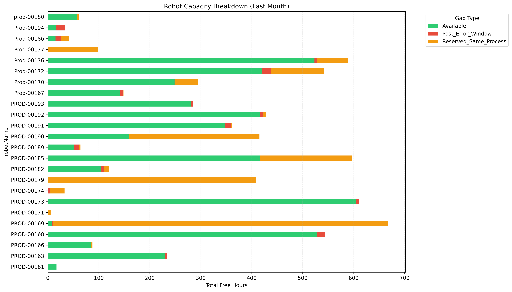
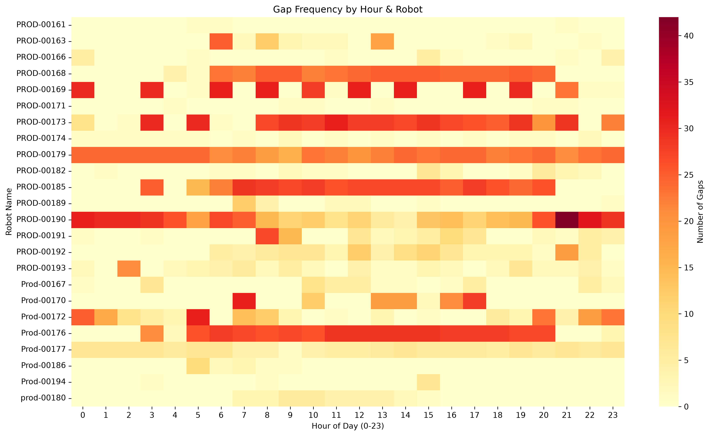
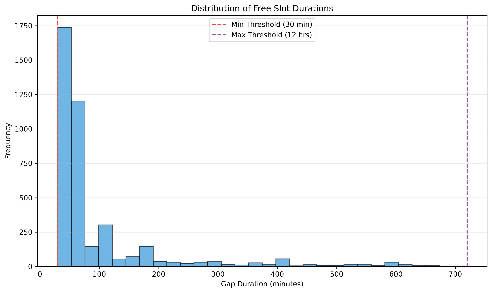

# UiPath Robot Capacity & Gap Analysis

> Find the idle windows between UiPath jobs — and prove which ones are truly free to schedule new work.

[](https://www.python.org/)
[](https://pandas.pydata.org/)
[](https://streamlit.io/)
[](https://plotly.com/python/)

**Live demo:** https://<your-app>.streamlit.app _(after Streamlit Community Cloud deploy — see [Deploy](#deploy-live-url))_

## Quick facts

| | |
|---|---|
| Raw jobs analysed | 248,057 (`Jobs.csv`, Jan–Feb 2026) |
| Free slots found | **4,077** in the last 1 month |
| Available for new processes | **2,405 (59.0%)** |
| Reserved (same process) | 1,630 (40.0%) |
| Post-error windows | 42 (1.0%) |
| Robots covered | 24 |

## Business Problem

UiPath Orchestrator schedules jobs back-to-back on each robot, but the
schedule always leaves gaps: setup time, waiting for triggers, failed-run
restarts. The RPA team needs to know **when a robot is genuinely idle and
safe to book new work** — without colliding with queued same-process jobs
or retry windows after failures.

This project answers that with a reproducible pipeline: raw job history →
cleaned gaps → classified capacity → interactive dashboards.

## Data Sources

| Source | Rows | What it contains | Sensitivity |
|--------|------|------------------|-------------|
| `Jobs.csv` | 248,057 × 21 cols | UiPath export: `jobId`, `jobStart`/`jobEnd`, `jobState`, `processName`, `releaseId`, `robotName`, `machineName`, `userName`, env/tenant | **Do not publish** — real Orchestrator data (94 MB). Git-ignored; only the aggregated output ships. |
| `Config.xlsx` (`Settings` sheet) | 20 keys | Thresholds (`MIN_GAP_MINUTES=30`, `MAX_GAP_HOURS=12`, `RETRY_WINDOW_MINUTES=35`, `LOOKBACK_MONTHS=1`) + infra paths | Contains credentials/hostnames — **never commit** (git-ignored). Thresholds are re-declared as defaults in code. |
| `data/Free_Slots_Analysis.csv` | 4,077 × 12 cols | Final gap table (anonymised robot ids only) | Safe to publish — feeds both dashboards. |

Sample pipeline run (`output/analysis.log`):

```
Loaded 248,057 rows → 22,029 in last month → 4,077 free slots
Available 2,405 (59.0%) · Reserved 1,630 (40.0%) · Post-error 42
```

## Data Cleaning & Reshaping (pandas)

All logic lives in `free_slots_v2.py` as small, testable functions:

1. **`load_config()`** — reads `Config.xlsx` `Name`/`Value` sheet into a typed
   `GapConfig` dataclass; invalid/missing values fall back to documented
   defaults **with a logged warning** (never silent).
2. **`clean_jobs()`** — `pd.to_datetime(errors="coerce")` on `jobStart`/`jobEnd`,
   drops rows missing `robotName`/`jobStart`/`jobEnd` (duplicates kept — they
   are distinct jobs).
3. **`compute_gaps()`** — sorts by `robotName, jobStart`, filters to the last
   `LOOKBACK_MONTHS` from `max(jobStart)`, then reshapes with a grouped
   `shift(-1)` to get each job's successor (`NextJobStart`, `NextProcess`).
   `GapDuration = NextJobStart − jobEnd`; the last job per robot (no
   successor) is dropped. Duration filter `[30 min, 12 h]` and retry filter
   (failed state + gap ≤ 35 min) are applied.
4. **`classify_gaps()`** — vectorised `np`-style assignment: same
   `processName` as next job → `Reserved_Same_Process`; else failed state →
   `Post_Error_Window`; else `Available`.
5. **`format_outputs()`** — projects to the stable 12-column schema
   (`robotName`, `Date`, `WeekDay`, `Busy Duration`, …, `Gap_Type`,
   `Safe_For_New_Process`) with human-readable durations (`12 hrs 33 mins`).

The original SQLite variant (`free_slots_from_sqlite.py`) is kept for
reference — it segments retry chains and merges overlapping gaps; differences
are called out in Assumptions A7.

## Assumptions & Methodology

The pipeline **generates `output/ASSUMPTIONS.md` on every run** via
`write_assumptions_log()` — the same table below, with the actual run's row
counts. This is the audit trail a reviewer needs.

| ID | Assumption | Value | Why |
|----|-----------|-------|-----|
| A1 | Min schedulable gap | 30 min | Shorter windows are setup/restart noise, not bookable slots |
| A2 | Max gap | 12 h | Longer idle time = overnight/maintenance, not a usable window |
| A3 | Retry window | 35 min, states Failed/Canceled/Faulted/Stopped | A failure restarting within 35 min is a retry, not free capacity |
| A4 | Classification | same process → Reserved; else failed → Post-Error; else Available | Same-process successor means queued work; only Available is safe |
| A5 | Lookback | 1 month from `max(jobStart)` | Anchored at data, not calendar month → reproducible re-runs |
| A6 | Invalid rows | drop missing key fields; drop last job per robot | No parseable timestamps / no successor ⇒ no gap |
| A7 | Date attribution | gap dated by `jobEnd` | Keeps `Date`/`WeekDay`/`Gap_From` consistent; **cross-midnight gaps are kept** (bounded by the 12 h cap) — check `Gap_From`/`Gap_To` before scheduling |

**Known limitations:** cross-midnight gaps are retained (unlike the SQLite
variant's same-day rule); Post-Error gaps are never `Safe_For_New_Process`;
threshold changes require re-running the pipeline (dashboards read the CSV).

## Visualizations / Dashboards

### Matplotlib charts (`output/` — static previews for GitHub)

The live dashboard now uses interactive Plotly (see Option B); these PNGs
remain as static snapshots because GitHub markdown can't render Plotly.







### Option A — Excel dashboard (`build_excel_dashboard.py`)

```bash
pip install pandas XlsxWriter openpyxl
python build_excel_dashboard.py          # → output/Free_Slots_Dashboard.xlsx
```

Sheets: `KPI_Summary` (live `COUNTIFS` + `XLOOKUP` formulas), `Pivots`
(robot × type, weekday × type), `Raw_Data` (4,077 rows, Table + filters +
conditional formatting), `Charts` (native bar chart). Proves the
**Excel / Pivot / XLOOKUP** requirement end-to-end.

### Option B — Interactive dashboard (`app.py`, Streamlit + Plotly)

```bash
pip install streamlit pandas plotly
streamlit run app.py
```

KPI cards (Total / Available / Reserved / Post-error), sidebar filters
(robot, gap type, weekday), and **three fully interactive Plotly charts**:
a stacked capacity bar per robot, an hour × robot heatmap, and a duration
histogram with the 30 min / 12 h thresholds marked. Charts **re-render live
when you change the filters** (hover, zoom, pan) — no static images. The
matplotlib PNGs in `output/` are kept only as static previews for GitHub's
markdown viewer (GitHub can't render interactive Plotly).
Deployed live — see next section.

Content is generated by `free_slots_v2.py`; both dashboards are read-only
wrappers around `data/Free_Slots_Analysis.csv`.

## Deploy live URL

The repo is Streamlit-Cloud-ready (`app.py` + `requirements.txt` + `data/`).
After pushing to GitHub:

1. Go to [share.streamlit.io](https://share.streamlit.io) → **New app**.
2. Repo: `TisTis0004/UiPath-Gap-Analysis`, branch `main`, main file `app.py`.
3. Click **Deploy** → you get `https://<app-name>.streamlit.app` — share that
   link anywhere. No AWS account needed.

## Project structure

```
.
├── free_slots_v2.py          # pipeline (pandas) + ASSUMPTIONS.md generator
├── free_slots_from_sqlite.py # original SQLite variant (reference)
├── build_excel_dashboard.py  # Excel dashboard builder (Option A)
├── app.py                    # Streamlit dashboard (Option B)
├── requirements.txt
├── data/Free_Slots_Analysis.csv   # published output (feeds app.py)
├── output/                          # local artefacts (charts, log, xlsx)
├── Jobs.csv / Config.xlsx           # raw inputs — git-ignored, never commit
└── README.md
```

## Run it yourself

```bash
git clone https://github.com/TisTis0004/UiPath-Gap-Analysis.git
cd UiPath-Gap-Analysis
pip install -r requirements.txt
python free_slots_v2.py        # Jobs.csv + Config.xlsx → output/
streamlit run app.py           # interactive dashboard
python build_excel_dashboard.py  # Excel workbook
```

## Why this repo (for recruiters)

- **Python / pandas** — grouped `shift` reshaping, vectorised classification,
  typed config, logged stage-by-stage row audits.
- **SQL** — the original `free_slots_from_sqlite.py` reads a curated SQLite
  `jobs_all` table (`SELECT … WHERE jobStart IS NOT NULL …`); the CSV pipeline
  is its portable twin.
- **Excel** — `build_excel_dashboard.py` emits pivot tables, `COUNTIFS`,
  `XLOOKUP`, conditional formatting and a native chart with XlsxWriter.
- **BI / Dashboarding** — `app.py` is a deployable Streamlit BI app (KPIs,
  filters, drill-down table), a Power-BI-in-code equivalent.
- **Data discipline** — every source, threshold and adjustment is recorded in
  the generated `ASSUMPTIONS.md`; raw/sensitive files are git-ignored.
